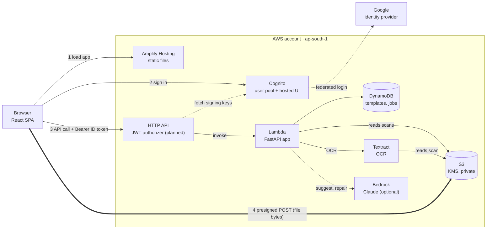
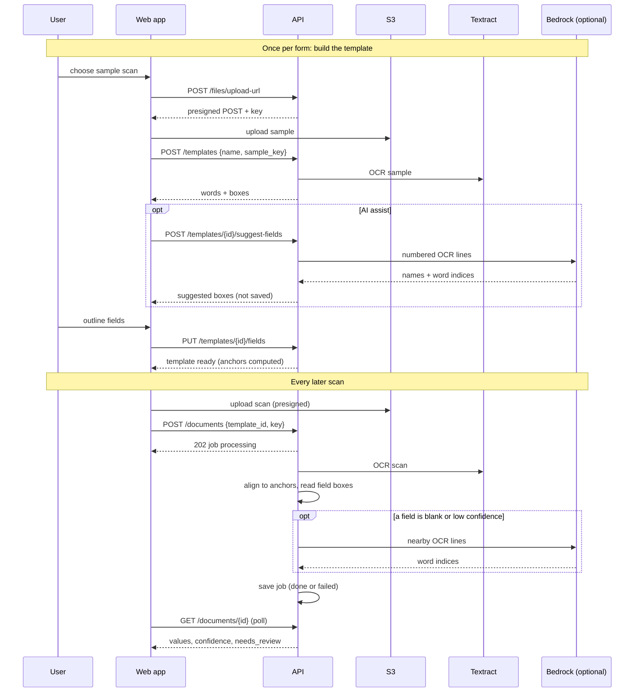
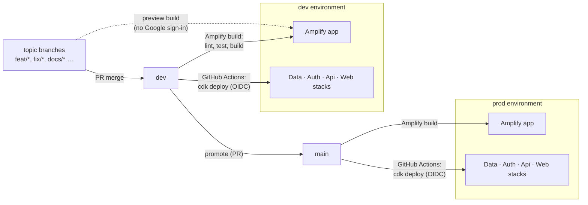

# Architecture

How the system fits together, and why. Companion documents: [TECH_STACK](TECH_STACK.md),
[PROJECT_STRUCTURE](PROJECT_STRUCTURE.md), [REPOSITORY](REPOSITORY.md) (how the single repository
is organised, built and deployed) and the decision records in [adr/](adr/README.md).

> **Status: design only.** This is the target design. No application code or infrastructure exists
> in this repository yet; each part is added in its own pull request (see the roadmap in the
> [README](../README.md)) and this document is updated in the same pull request to say what is built.
> Behaviour specs and the engineering practices are documented in the pull requests that follow.

## 1. What the system does

A user teaches the system what a form looks like once (a **template**, built from one filled sample),
then uploads further scans of the same form and gets the field values back, with doubtful values
flagged for a human to check.

## 2. Runtime view



Key properties:

- **Files bypass the API.** The browser uploads to S3 with a presigned POST that pins type and size
  ([ADR-0006](adr/0006-direct-to-s3-uploads.md)).
- **The API is the only component that touches data.** It verifies the Cognito **ID token**
  (signature, issuer, audience, expiry, `token_use=id`), takes `sub` as `owner_id`, and every read is
  scoped to it ([ADR-0005](adr/0005-dynamodb-owner-partition.md)).
- **Deterministic first, LLM last.** OCR plus geometry does the extraction; the LLM only selects OCR
  words by index ([ADR-0004](adr/0004-llm-selects-ocr-words.md)).

## 3. How extraction works



### The alignment algorithm (`app/extractor.py`, pure Python)

1. **Boxes are fractions of the page** (0 to 1), so image resolution does not matter.
2. **Anchors** are fixed printed labels in the sample: words that are unique, confident (at least 90)
   and outside every mapped field. They are saved with the template.
3. For a new scan, anchors are matched to OCR words **by text** (ambiguous matches are skipped) and a
   robust least-squares fit per axis (`x' = sx·x + tx`, `y' = sy·y + ty`) absorbs scale and offset
   differences. Pairs with large residuals are dropped and the fit is repeated.
4. Each field box is projected through the fit and the OCR words whose centre lies inside are joined
   in reading order. Mean confidence below 85, or no words, sets `needs_review`.
5. Fewer than 4 matched anchors means the scan is a different form and the job fails with that reason.

Limits: page 1 only, no rotation/skew correction, text only.

## 4. Data and storage

**DynamoDB** (one table per entity, partition key `owner_id`, sort key `id`):

| Table       | Sort key                       | Holds                                                               |
| ----------- | ------------------------------ | ------------------------------------------------------------------- |
| `templates` | uuid                           | template JSON: name, sample key, OCR words, fields, anchors, status |
| `jobs`      | `<epoch-ms>-<rand>` (sortable) | job JSON: template id, document key, status, alignment, results     |

**S3** (one bucket per environment, KMS-encrypted, public access blocked):

```
{sub}/templates/{uuid}.{png|jpg|pdf}   samples      kept
{sub}/documents/{uuid}.{png|jpg|pdf}   scans        expire after 90 days
```

Object keys are minted by the API; any key outside the caller's prefix is refused.

## 5. Delivery view



- Two complete copies of the stacks in one AWS account, selected by a CDK context value
  ([ADR-0003](adr/0003-amplify-hosting-two-environments.md)).
- Infrastructure is AWS CDK in TypeScript ([ADR-0002](adr/0002-cdk-for-infrastructure.md)). A plain
  CloudFormation template for the S3 bucket, KMS key, DynamoDB tables, Cognito (with Google) and the
  app's IAM policy is the planned interim before the CDK stacks.
- The web app, the Lambda API and the infrastructure live in **one repository** and deploy through
  separate paths. How that is organised, built, tested and released is in [REPOSITORY](REPOSITORY.md)
  ([ADR-0008](adr/0008-single-repository.md)).
- CI is the enforcement point for quality gates (added in a later pull request).

## 6. Security model

| Concern               | Mechanism                                                                                |
| --------------------- | ---------------------------------------------------------------------------------------- |
| Who is calling        | Cognito ID token verified on every route except `/health`                                |
| Cross-user access     | Data keyed by `owner_id`; foreign object keys refused (403), foreign ids not found (404) |
| File upload abuse     | Presigned POST pins content type and size; only JPEG, PNG, PDF                           |
| Data at rest          | S3 and DynamoDB encrypted (KMS for S3); private bucket; 90-day expiry on scans           |
| Hostile document text | Treated as data; LLM only returns indices, validated; values come from OCR               |
| Secrets               | Google client secret from Secrets Manager (planned); none in the repo; `.env` ignored    |
| Least privilege       | App IAM policy limited to the bucket, two tables, Textract, Bedrock invoke               |
| Supply chain          | Lockfiles, Dependabot, `pip-audit`, `npm audit`, `bandit` in CI                          |
| Local mode            | `BACKEND=local` disables auth; must never be set in a deployed environment               |

## 7. Operating limits and known trade-offs

- Extraction runs inside the request lifecycle (a background task). Under Lambda it finishes before
  the response is returned. Fine for single images; move to SQS plus a worker for PDFs or volume.
- Only page 1 is read; PDFs go through Textract's asynchronous API and are polled for up to 60 s.
- Scans must be upright. Add deskew (or a full homography) before relying on phone photos.
- Handwriting and checkboxes need Textract `AnalyzeDocument` (forms, signatures).
- No quotas or rate limiting per user in the first version.
- Behaviour against live Cognito, S3, Textract and Bedrock must be verified in each environment once built;
  automated tests will use fakes for these services.
