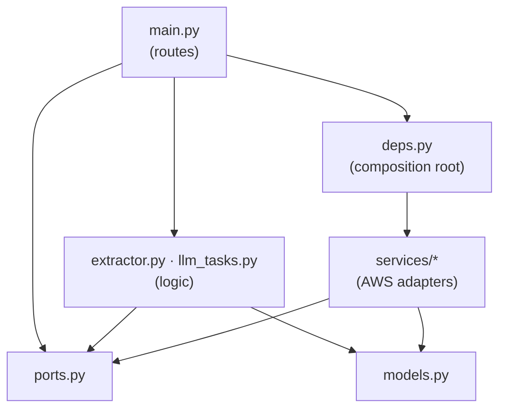

# Project structure

One repository, three deployable parts (API, web app, infrastructure) and the tooling around them.
How the parts are built, tested and deployed together is in [REPOSITORY](REPOSITORY.md).

> **This is the target layout.** Folders and files appear as the roadmap pull requests land; the
> "Repository layout" section of the [README](../README.md) lists what exists today.

```
.
├── app/                        FastAPI backend (Python)
│   ├── main.py                 HTTP routes, request orchestration (thin)
│   ├── models.py               Pydantic models: domain objects and API payloads
│   ├── ports.py                Protocols the app needs: FileStore, OCR, Repository, LLMClient
│   ├── deps.py                 Composition root: picks AWS or local adapters
│   ├── config.py               Settings from environment variables
│   ├── auth.py                 Cognito ID-token verification, `current_user` dependency
│   ├── extractor.py            Pure logic: anchors, alignment, field reading (no I/O)
│   ├── llm_tasks.py            Pure-ish logic: LLM prompts and index-to-box mapping
│   ├── lambda_handler.py       Mangum entry point for Lambda
│   └── services/               Adapters (the only code that talks to AWS)
│       ├── storage.py          S3Storage, LocalStorage      → FileStore
│       ├── ocr.py              TextractOCR, LocalOCR        → OCR
│       ├── repo.py             DynamoRepo, MemoryRepo       → Repository
│       └── llm.py              BedrockLLM                   → LLMClient
│
├── web/                        React + TypeScript SPA (Vite)
│   └── src/
│       ├── main.tsx            Bootstrap (Amplify config, providers, router)
│       ├── App.tsx             Routes
│       ├── api.ts              Typed API client (one place that knows URLs and tokens)
│       ├── types.ts            Types mirroring the API models
│       ├── auth/               Auth context + Amplify-backed provider
│       ├── pages/              One component per screen (+ colocated *.test.tsx)
│       ├── components/         Shared UI (Layout, Protected)
│       ├── lib/                Pure helpers (geometry)
│       └── test/               Test setup and helpers
│
├── e2e/                        Playwright browser tests (full stack in local mode)
│   ├── *.spec.ts
│   └── fixtures/               Sample images + fake OCR word lists (+ generator script)
│
├── tests/                      Python tests
│   ├── unit/                   Pure logic and adapters (moto, fake clients)
│   ├── integration/            HTTP API through TestClient with in-memory adapters
│   └── factories.py            Shared test data (the sample form)
│
├── infra/
│   ├── template.yaml           CloudFormation, interim (S3, KMS, DynamoDB, Cognito, IAM)
│   └── cdk/                    AWS CDK app: Data, Auth, Api, Web stacks, per environment
│
├── docs/
│   ├── ARCHITECTURE.md  TECH_STACK.md  PROJECT_STRUCTURE.md  REPOSITORY.md
│   ├── DESIGN_PATTERNS.md  ENGINEERING_PRACTICES.md  CODE_REVIEW.md  TESTING.md
│   ├── SPEC_DRIVEN_DEVELOPMENT.md
│   ├── specs/                  Behaviour specs with numbered acceptance criteria
│   └── adr/                    Architecture decision records
│
├── scripts/                    Repo scripts (spec traceability check, tool launcher)
├── .github/                    CI workflow, PR template, Dependabot
├── .husky/                     Git hooks: pre-commit, commit-msg, pre-push
├── amplify.yml                 Amplify Hosting build spec (appRoot: web)
├── Makefile                    The one command surface: setup, lint, test, e2e, check …
├── pyproject.toml              Ruff, mypy, pytest, coverage configuration
├── requirements.txt            Runtime Python dependencies (pinned)
├── requirements-dev.txt        Test and analysis tools (pinned)
├── package.json                Repo tooling only: Husky, lint-staged, commitlint, Prettier, Playwright
├── playwright.config.ts        Starts API + web in local mode for e2e
├── lint-staged.config.mjs      What runs on staged files
├── commitlint.config.mjs       Commit message rules
└── .prettierrc.json  .editorconfig  .nvmrc  .python-version  .env.example
```

## Dependency rules (the architecture, enforced by review)



1. `extractor.py` imports no AWS and does no I/O. It must stay testable with plain objects.
2. Only `app/services/*` import `boto3`. Everything else depends on `ports.py`.
3. Only `deps.py` chooses a concrete adapter. Tests replace `deps.repo`, `deps.ocr`, `deps.llm`.
4. Routes in `main.py` are thin: authenticate, validate, call logic and ports, shape the response.
5. In the web app, only `api.ts` calls `fetch`; only `auth/` imports Amplify; pages never build URLs.

## Where does new code go?

| I am adding…                       | Put it in                                                                                  |
| ---------------------------------- | ------------------------------------------------------------------------------------------ |
| A new API route                    | `app/main.py` (route) + models in `models.py`; spec first; integration test                |
| New business rule on OCR geometry  | `app/extractor.py`, with a unit test using `tests/factories.py`                            |
| A new external service             | A Protocol in `ports.py`, adapter in `services/`, wiring in `deps.py`, fake in tests       |
| A new screen                       | `web/src/pages/X.tsx` + `X.test.tsx`; route in `App.tsx`; call through `api.ts`            |
| A reusable UI piece used twice     | `web/src/components/`                                                                      |
| Pure web helper                    | `web/src/lib/` with a unit test                                                            |
| A user journey                     | `e2e/*.spec.ts` (keep the number small; the testing guide follows in a later pull request) |
| A decision that is hard to reverse | `docs/adr/NNNN-title.md`                                                                   |
| A behaviour change                 | `docs/specs/SPEC-0XX-*.md` first                                                           |

## Naming and conventions

- Python: `snake_case`, type hints everywhere (mypy strict), Ruff-formatted, 100 columns.
- TypeScript: `PascalCase.tsx` for components, `camelCase.ts` otherwise, Prettier (no semicolons,
  single quotes), tests beside the code as `X.test.tsx`.
- Branches: `<type>/<topic>` where type is `feat`, `fix`, `docs`, `chore`, `test` or `infra`;
  long-lived `dev` and `main` (see [CONTRIBUTING](../CONTRIBUTING.md)).
- Commits: Conventional Commits with a scope from `api, web, infra, e2e, docs, ci, deps, repo`.
- API JSON and Python models use `snake_case` end to end (no translation layer).
