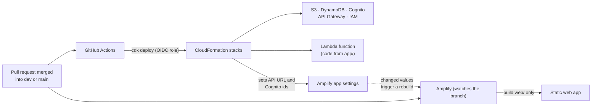

# Repository and delivery management

How the single repository is organised, how its three parts are built, tested and deployed, and how
a change travels from a pull request to production. The decision and its trade-offs are in
[ADR-0008](adr/0008-single-repository.md). Folder-level detail is in
[PROJECT_STRUCTURE](PROJECT_STRUCTURE.md); the system design is in [ARCHITECTURE](ARCHITECTURE.md).

> **Status: design only.** Everything here is the plan. The parts and the automation are added by
> the pull requests in the [README](../README.md) roadmap, and this page is updated as they land.

## 1. One repository, three deployable parts

```
.
├── app/         API: Python, FastAPI            → runs as an AWS Lambda function
├── web/         Web app: React, TypeScript      → built and hosted by AWS Amplify
├── infra/cdk/   Infrastructure: AWS CDK (TS)    → provisions everything above
├── e2e/         Browser tests that run web + API together
├── tests/       Python tests for app/
└── docs/        Architecture, decisions, practices
```

| Part           | Folder       | Language   | Own dependencies         | Own checks (planned)               | Deployed by                        |
| -------------- | ------------ | ---------- | ------------------------ | ---------------------------------- | ---------------------------------- |
| API            | `app/`       | Python     | `requirements*.txt`      | Ruff, mypy, pytest + coverage      | `cdk deploy` packages it as Lambda |
| Web app        | `web/`       | TypeScript | `web/package.json`       | ESLint, tsc, Vitest, build         | Amplify Hosting                    |
| Infrastructure | `infra/cdk/` | TypeScript | `infra/cdk/package.json` | tsc, Jest stack tests, `cdk synth` | GitHub Actions: `cdk deploy`       |
| Browser tests  | `e2e/`       | TypeScript | root `package.json`      | Playwright                         | not deployed; runs in CI           |
| Repo tooling   | repo root    | JS/config  | root `package.json`      | Husky, lint-staged, commitlint     | not deployed                       |

Each part owns its dependencies and lockfile, so upgrading React never touches the Python
environment. The root `package.json` holds only repository-wide tooling.

## 2. From a push to a running environment



- **One merge starts two deploys.** GitHub Actions deploys the infrastructure and the Lambda code in
  the same `cdk deploy`. Amplify independently builds and publishes `web/`.
- **The API address and sign-in settings are baked into the web build.** When CDK changes them,
  Amplify must rebuild; the pipeline triggers that rebuild.
- **No long-lived AWS keys.** GitHub Actions authenticates to AWS with an OIDC role.

## 3. Branches and environments

| Git branch                    | Environment                              | What happens on merge                                   |
| ----------------------------- | ---------------------------------------- | ------------------------------------------------------- |
| `feat/*`, `fix/*`, `docs/*` … | none (CI only; optional Amplify preview) | Checks run on the pull request into `dev`               |
| `dev`                         | **dev** (own copy of every resource)     | Deploys infrastructure, API and web to dev              |
| `main`                        | **prod** (own copy of every resource)    | Deploys to prod; reached only by a release pull request |

Dev and prod are two complete copies of the same stacks in one AWS account, selected by a CDK
context value ([ADR-0003](adr/0003-amplify-hosting-two-environments.md)). Feature-branch Amplify
previews cannot use Google sign-in (Cognito has no wildcard callback URLs), so sign-in is tested
locally or on `dev`.

## 4. What CI runs for which change

Path filters keep pull requests fast: a change only runs the checks it can affect.

| Files changed                                           | Jobs that run                                          |
| ------------------------------------------------------- | ------------------------------------------------------ |
| `app/**`, `tests/**`, `requirements*`, `pyproject.toml` | API checks, then end-to-end                            |
| `web/**`                                                | Web checks, then end-to-end                            |
| `infra/**`                                              | Infrastructure checks (type check, tests, `cdk synth`) |
| `e2e/**`                                                | End-to-end                                             |
| `docs/**`, `*.md`                                       | Formatting and link checks only                        |
| `.github/**`, root tooling files                        | Everything                                             |

Branch protection needs a status check that always reports. A required check from a skipped
workflow would block the merge forever, so a final **"all checks" job** aggregates the others
(skipped counts as passed) and is the only check marked required.

## 5. Changes that span parts

A new field is a good example: the API returns it, the web app shows it.

1. Make it **one pull request**: one review, one squash commit, tests for both sides.
2. Keep the API change **backward compatible for one release**. The two parts finish deploying at
   slightly different times, so for a short while the old web app talks to the new API or the new
   web app to the old API. Add fields; do not rename or remove them in the same pull request.
3. Remove old fields in a later pull request, once nothing uses them.
4. The API's request and response models are the contract. The end-to-end test and the web tests
   catch most mismatches before merge.

## 6. Versioning and releases

- No per-part version numbers. A running environment is identified by the **git commit** it was
  deployed from, and both parts always come from the same commit.
- A release is a pull request from `dev` to `main`, merged with a normal merge commit. Optionally
  tag it (`v0.1.0`) for a readable history.
- Hotfix: branch from `main`, pull request into `main`, then merge `main` back into `dev`.
- Rollback: revert the merge commit on the branch and let the pipeline redeploy. Stateful resources
  (S3, DynamoDB, KMS) are never replaced or deleted by a deploy.

## 7. Local development

One command surface (a `Makefile`, added with the tooling) hides the three toolchains:
`make setup`, `make check`, `make e2e`, `make dev-api`, `make dev-web`. Local mode replaces AWS with
in-memory stand-ins, so the API, web app and browser tests all run on a laptop with no AWS account.

## 8. When to split the repository

Split only when a real pressure appears: a second team that needs separate permissions or release
timing, a part that must be open or closed differently from the rest, or CI times that path filters
can no longer contain. Until then, the cost of coordinating three repositories exceeds the benefit.

## 9. Ownership

Today one developer owns everything, so there is no `CODEOWNERS` file and branch protection requires
a pull request but no second approval. If a second person joins, add `CODEOWNERS` per folder and
require their review for that folder.
